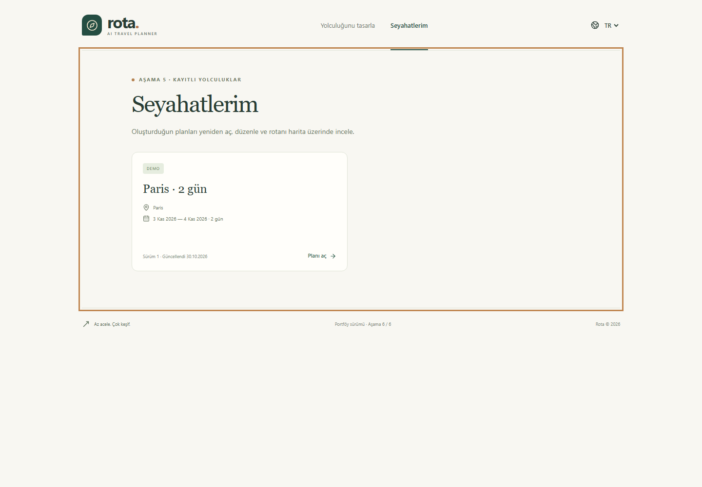
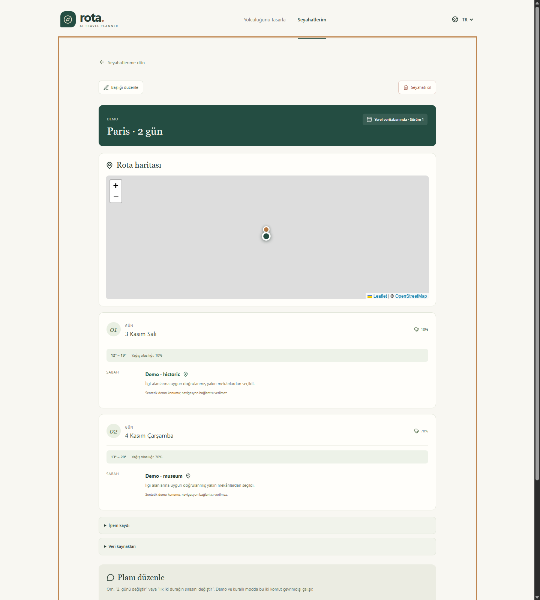
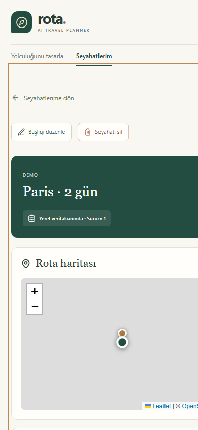
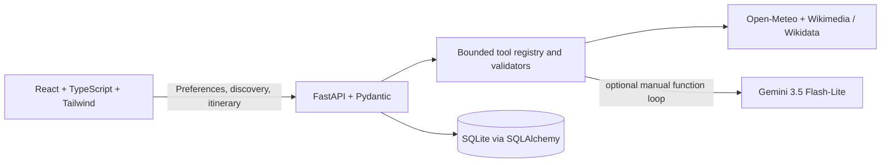
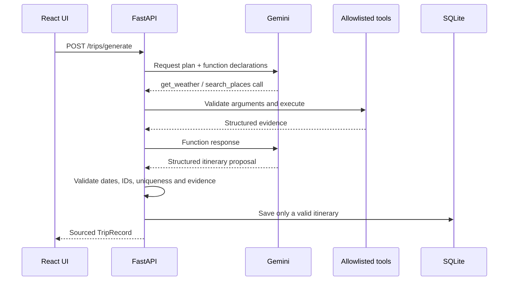

# Rota — AI Travel Planner

A travel planner built with React, TypeScript, Tailwind CSS and FastAPI, with a strict free-service-first roadmap.

**Status: Phase 6 complete (v0.6.0).** This portfolio-ready local release completes the product flow, offline test suite, repository safety check, reproducible setup documentation, architecture narrative and demonstration assets. Users can generate and save a validated itinerary, inspect its Leaflet route and daily weather, reopen it from My Trips, rename it, revise a specific day from stored evidence, and delete it.

Gemini 3.5 Flash-Lite is the only reviewed model allowed by this release. The bounded SDK connection and complete live tool-calling itinerary were verified locally in Docker on 2026-11-01 with an operator-confirmed Free Tier project; no key is stored in the repository. Google Maps and Search grounding remain disabled: the reviewed pricing page does not offer them on this model's API Free tier. See [Gemini setup](docs/gemini-setup.md).

Open-Meteo city/weather and Wikimedia/Wikidata place discovery succeeded in live checks. Paris returned 18 typed, coordinate-backed places in about four seconds. Public Overpass remains a bounded real-data fallback. See [test evidence](docs/testing.md).

[Türkçe kurulum ve kullanım](README.tr.md) · [Development progress](docs/development-progress.md) · [Teacher demonstration](docs/teacher-demo.md) · [Free-service checklist](docs/free-services.md)

## Purpose and learning objectives

Rota demonstrates how to build a transparent full-stack AI product without hiding external calls behind a chat box. It is intended as a portfolio and teaching project for React/FastAPI boundaries, typed API contracts, bounded function calling, evidence validation, provider failure handling, local persistence, accessible bilingual UI and deterministic offline testing.


| Saved trips | Itinerary and map | Mobile detail |
|---|---|---|
|  |  |  |

## What works

- Responsive Turkish/English interface with an original coastal SVG illustration; no remote fonts or image services.
- Destination, date, interest, budget, pace and notes form.
- Shared frontend/backend validation: one to fourteen inclusive days, required interests and bounded text.
- Real FastAPI health check, connection error state and retry.
- Backend-validated preference summary; data stays in React memory while navigating and resets on refresh.
- Explicit city selection, optional country filtering and ambiguous-city handling.
- Date-aligned weather, local time zones, missing values and forecast-window handling.
- Bounded nearby place queries from Wikimedia/Wikidata with source links, attribution and coordinate/classification quality; Overpass remains a fallback.
- Independent loading/error/retry states, cached response labels, request limits and an explicit offline demo.
- Opt-in Gemini status and connection checks with no automatic model, paid-tier or grounding fallback.
- Bounded manual Gemini function-calling loop with an allowlisted weather/place tool registry.
- Deterministic, evidence-based itinerary generation when AI is not selected; no silent fallback.
- Exact date coverage, known-place enforcement, duplicate checks, weather alternatives and source metadata.
- SQLite persistence plus list/get/rename/delete APIs and natural-language revision using stored evidence.
- Interactive OpenStreetMap/Leaflet route linked to the daily timeline, source citations and keyless Google Maps direction URLs for verified non-demo coordinates.
- Complete My Trips UI with loading/error/empty states, reopen, rename, revision history and deletion confirmation.
- Idempotent generation prevents a repeated submit from creating duplicate saved trips.
- Safe handling for missing/rejected keys, quotas, timeouts, invalid output and provider outages.
- Explicit empty states for future saved trips and direct navigation without a draft.
- Strict TypeScript, frontend component tests, backend API tests, linting and an offline application-test CI workflow.

## Requirements

- Node.js **24.12 or newer**; the project was verified with Node 24.12.0 and npm 11.6.2.
- Python **3.11 or newer**; verified locally with Python 3.13.0.
- Two terminals for manual development, or the included Windows start script after installation.
- Internet for dependency installation, live discovery and an optional Gemini check. Tests and explicit demo mode need no provider access.

Dependency versions are recorded in `frontend/package-lock.json` and `backend/requirements-lock.txt`. The latter pins the verified Python environment, including developer tools. `backend/pyproject.toml` declares the application dependencies.

## Windows PowerShell

Open a terminal in this `ai-travel-planner` directory.

Backend installation and startup:

```powershell
cd backend
python -m venv .venv
.\.venv\Scripts\python.exe -m pip install -r requirements-lock.txt
Copy-Item .env.example .env
.\.venv\Scripts\python.exe -m uvicorn app.main:app --host 127.0.0.1 --port 8000
```

In a second terminal from the project directory:

```powershell
cd frontend
npm.cmd ci
Copy-Item .env.example .env
npm.cmd run dev
```

Copy example environment files only on first setup; preserve any existing `.env`. Defaults work without copying either file. Keep Gemini settings empty and grounding flags false.

After installation, a single terminal can run both processes from the project directory:

```powershell
powershell -NoProfile -File .\scripts\start.ps1
```

The script prints both addresses and stops its own processes when interrupted with Ctrl+C. Ports 8000 and 5173 must be available. It does not install packages, create keys or configure billing. Live provider requests require explicit user actions. If PowerShell policy blocks a script, use the manual terminal commands above.

## macOS / Linux

```bash
cd backend
python3 -m venv .venv
.venv/bin/python -m pip install -r requirements-lock.txt
cp .env.example .env
.venv/bin/python -m uvicorn app.main:app --host 127.0.0.1 --port 8000
```

In another terminal:

```bash
cd frontend
npm ci
cp .env.example .env
npm run dev
```

The commands are documented for portability; this implementation was executed and browser-verified on Windows, not on macOS/Linux.

## Local addresses

- Application: [http://127.0.0.1:5173](http://127.0.0.1:5173)
- API documentation: [http://127.0.0.1:8000/docs](http://127.0.0.1:8000/docs)
- Health: [http://127.0.0.1:8000/api/health](http://127.0.0.1:8000/api/health)

The UI also works at `http://localhost:5173`, which is an allowed CORS origin. A different frontend origin must be added to the backend's `CORS_ORIGINS`. `VITE_API_BASE_URL` contains only the public backend address, never a secret. Restart the appropriate process after changing an environment file.

## API in this phase

| Method | Route | Behavior |
|---|---|---|
| GET | `/api/health` | Local process health; zero provider calls |
| GET | `/api/capabilities` | Implemented features and disabled providers; no secrets |
| POST | `/api/trip-requests/validate` | Validates/normalizes preferences without saving or generating |
| GET | `/api/destinations` | Candidates: `q`, optional `country_code`, `language`, `mode` |
| GET | `/api/weather` | Daily weather: `destination_id`, `start_date`, `end_date`, `mode` |
| GET | `/api/places` | Places: `destination_id`, repeated `categories`, optional `radius_m`, `mode` |
| GET | `/api/ai/status` | Safe configuration/capability state; never calls Gemini |
| POST | `/api/ai/check` | One bounded structured Gemini connection test; body contains only `language` |
| POST | `/api/research` | Structured unavailable result for gated Maps/Search research |
| POST | `/api/trips/generate` | Generate, validate and persist an AI, deterministic or demo itinerary |
| GET | `/api/trips` | List saved local trips |
| GET | `/api/trips/{id}` | Read one saved trip |
| POST | `/api/trips/{id}/revise` | Revise from stored evidence without refetching providers |
| PATCH | `/api/trips/{id}` | Rename a saved trip |
| DELETE | `/api/trips/{id}` | Delete a saved trip |

Example validation body:

```json
{
  "destination": "Barcelona, Spain",
  "start_date": "2027-02-01",
  "end_date": "2027-02-04",
  "interests": ["culture", "food"],
  "budget": "balanced",
  "pace": "relaxed",
  "language": "en",
  "notes": "Local cafés and museums."
}
```

A successful response has `status: "preferences_validated"`, `duration_days: 4`, normalized `request`, and `itinerary_generated: false`. The preference endpoint validates city text; the separate discovery step resolves the actual city. Past dates are permitted for drafting but weather outside the forecast window is unavailable.

Discovery defaults to `mode=live`; `mode=demo` performs no provider calls. Search first and pass the selected returned ID with the same mode. The generation endpoint accepts `generation_mode=ai|deterministic|demo`; demo must use demo data, while AI/deterministic modes must use live data. A client-generated UUID `idempotency_key` is required and repeated requests with that key return the original saved trip. There is no automatic mode switch. See [Phase 4 agent details](docs/phase-4-agent.md), [API details and budgets](docs/architecture.md), [Phase 5 product details](docs/phase-5-product.md) and the [demo walkthrough](docs/demo.md).

Gemini status is read-only. A live check is enabled only when `FREE_ONLY_MODE=true`, the model equals `gemini-3.5-flash-lite`, a key exists, and the operator has set `GEMINI_FREE_TIER_CONFIRMED=true` after checking the account. This flag is an attestation, not a billing API. The check sends a fixed connection prompt and language only; trip details and notes are not sent. Free-tier prompts/responses may be used by Google to improve products and may be human reviewed, so do not send sensitive information. Full steps: [Gemini setup](docs/gemini-setup.md).

## Checks

From `backend` on Windows:

```powershell
.\.venv\Scripts\python.exe -m pytest -q
.\.venv\Scripts\python.exe -m ruff check app tests
.\.venv\Scripts\python.exe -m pip check
```

On macOS/Linux, substitute `.venv/bin/python`.

From `frontend`:

```bash
npm run typecheck
npm run lint
npm test
npm run build
```

The frontend uses Vite's native configuration loader and Vitest worker threads, avoiding unnecessary subprocesses in restricted Windows environments. `npm run preview` serves the production build on port 4173; add that origin to backend CORS when testing API calls there. The normal development route uses port 5173.

See [testing notes](docs/testing.md) for actual executed checks and browser verification. CI is supplied for GitHub, but no repository has been published and no remote workflow has been run.

## Architecture and next steps



The optional Gemini path uses a manual, server-controlled sequence:



The model never calls providers directly. The backend accepts only declared tool names and validated arguments, enforces step/tool/time budgets, materializes provider-owned place data, and rejects invalid final JSON. Deterministic and demo generation use the same validators without making a model request.

The Gemini connection and complete two-turn tool-calling path are live-verified with an eligible local Free Tier key and remain covered by an offline fake-model contract. Function calling and the structured final response run as separate model turns for compatibility. Google Maps/Search grounding is disabled for the reviewed model/account path.

## Limits and privacy

This is a local single-user development application. Notes are not sent to discovery providers. When AI generation is explicitly selected, the trip request including notes and the public tool evidence is sent to Gemini; the UI warns against sensitive content. Deterministic/demo generation makes no model call. Validated trips and evidence are stored in the local SQLite database under `backend/data`; `.gitignore` excludes it. No browser geolocation is requested.

Capabilities report implemented integrations, not provider reachability. Gemini/Google flags remain inert until those integrations and eligibility checks exist. Public endpoints are for low-volume, non-commercial local development; process-local limits do not replace provider policies or production infrastructure.

Do not expose the development servers publicly. No billing is configured, no paid APIs are included, and no paid fallback is included. Read [the service checklist](docs/free-services.md) before enabling future integrations. The original SVG is stored in source and needs no third-party image service.

## Attribution and data use

Live city and weather data come from Open-Meteo under its published terms. Place discovery uses coordinate-backed Wikipedia pages classified through Wikidata, with record links and contributor attribution; the data is available under the sources' respective licenses. Overpass is retained as a bounded fallback. Map tiles remain attributed to © OpenStreetMap contributors. Google Maps URLs are ordinary keyless navigation links, not Places or grounding API calls. Provider responses may be incomplete and remain subject to provider quotas, retention terms and licenses.

## Reproducible verification

After following the installation steps, Windows users can run every offline application check with:

```powershell
powershell -NoProfile -File .\scripts\verify.ps1
```

The command scans repository files for local databases, environment files and recognizable credentials; then runs backend lint/tests/dependency checks and frontend typecheck/lint/tests/build. GitHub Actions performs the same network-free application checks after dependency installation. No test needs API keys, live providers or billable services.

## Free portfolio deployment

The root `render.yaml` builds React and serves it with FastAPI from one Render Free web service. The first deployment needs no Gemini secret and supports demo/deterministic generation. Render's Free filesystem is ephemeral, so hosted SQLite trips can disappear after sleep, restart, or redeployment. This is an honest portfolio demo rather than durable storage. Follow the [deployment guide](docs/deployment.md) before connecting GitHub or adding a Free-tier Gemini key.

## Docker presentation

Run the complete production build locally in one container:

```bash
docker compose up --build
```

Then open [http://localhost:8000](http://localhost:8000). This keyless command supports the complete demo flow. To enable the locally configured Gemini Free Tier key without copying it into the image, use `docker compose --env-file backend/.env up --build`. The named `travel-data` volume preserves SQLite trips across normal container restarts. See the [Docker presentation guide](docs/docker.md) for clean-machine and presentation-day instructions.

## Roadmap

The agreed local MVP is complete and configured for a free portfolio deployment. Optional future work includes PDF export, user accounts, durable PostgreSQL, advanced routing, broader accessibility audits and live-provider observability. These must retain the free-service and explicit-consent rules.

Setup references: [Vite guide](https://vite.dev/guide/), [Tailwind Vite integration](https://tailwindcss.com/docs/installation/using-vite), [FastAPI first steps](https://fastapi.tiangolo.com/tutorial/first-steps/).
