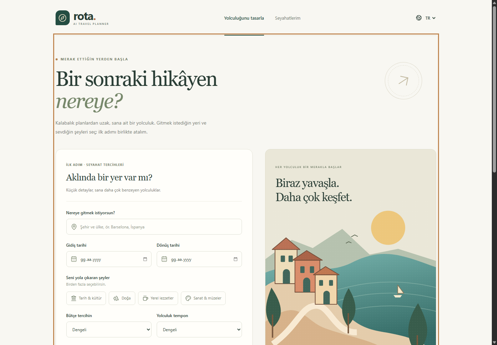
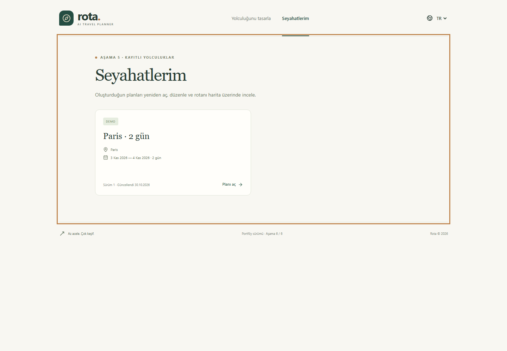
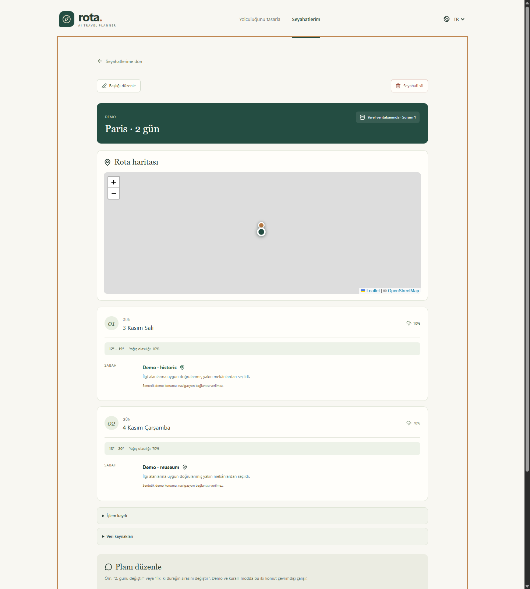
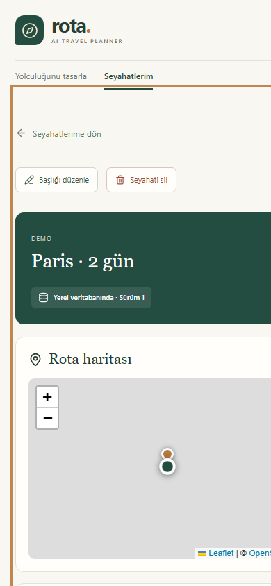

# Rota — AI Travel Planner

React + TypeScript + Tailwind arayüzü ve FastAPI backend'i ile geliştirilen seyahat planlayıcısı.

**Aşama 6 tamamlandı (v0.6.0).** Yerel ürün akışı, çevrimdışı testler, depo güvenlik taraması, temiz kurulum belgeleri, mimari anlatım ve sunum görselleri hazır. Doğrulanmış plan oluşturma/kaydetme, Leaflet rota haritası, günlük hava, kaynaklar, “Seyahatlerim”, başlık düzenleme, revizyon geçmişi ve silme akışları tamamlandı.

Sınırlı Gemini SDK bağlantı kontrolü ve tam canlı araç çağırmalı seyahat üretimi, kullanıcı tarafından Free Tier olduğu doğrulanan yerel bir projeyle 2026-11-01 tarihinde Docker içinde başarıyla çalıştı; anahtar depoda tutulmaz. Bu sürüm yalnızca ücretsiz katmanı bulunan `gemini-3.5-flash-lite` modeline izin verir. Google Maps/Search grounding, seçilen modelin API ücretsiz katmanında sunulmadığı için kapalıdır.

Open-Meteo şehir/hava durumu ve Wikimedia/Wikidata gerçek mekân bağlantıları canlı olarak doğrulandı. Paris için yaklaşık dört saniyede 18 koordinatlı ve kategorilendirilmiş gerçek mekân döndü. Overpass sınırlı bir gerçek veri yedeği olarak korunur.

## Amaç ve eğitim hedefleri

Rota; React/FastAPI sınırlarını, tipli API sözleşmelerini, sınırlandırılmış function calling akışını, kanıt doğrulamasını, servis hatalarını, SQLite kalıcılığını, erişilebilir iki dilli arayüzü ve deterministik çevrimdışı testleri tek bir portföy projesinde gösterir.



| Kayıtlı seyahatler | Rota detayı ve harita | Mobil detay |
|---|---|---|
|  |  |  |

## Şu an kullanabileceklerin

- Türkçe/İngilizce ve mobil uyumlu arayüz.
- Şehir, tarih, ilgi alanı, bütçe, tempo ve not girişi.
- Hatalı girişleri gösteren form ve backend doğrulaması.
- Gerçek bağlantı kontrolü ve yeniden deneme düğmesi.
- Doğrulanan tercihlerin özeti; düzenlemeye dönüldüğünde bilgilerin korunması.
- Aynı adlı şehirler arasından ülke/bölge bilgisiyle seçim ve isteğe bağlı ülke filtresi.
- Günlük hava kartları; eksik veri ve tahmin aralığı dışındaki tarihler için açık mesajlar.
- OSM kaynak bağlantıları, veri zamanı, önbellek ve koordinat doğruluğu bilgileriyle mekân listesi.
- Bağımsız hata/yeniden deneme akışı ve açıkça seçilen çevrimdışı demo.
- Gemini ayar durumu ve kullanıcı tarafından başlatılan bağlantı kontrolü.
- Eksik/geçersiz anahtar, kota, zaman aşımı ve hatalı yanıtlar için güvenli mesajlar.
- İzinli araç adları ve çağrı/turn sınırları olan gerçek Gemini function-calling döngüsü.
- Gemini seçilmediğinde gerçek veriyi belgelenmiş puanlama kurallarıyla kullanan kurallı planlayıcı.
- Her günü kapsayan, yalnızca dönen mekân kimliklerini kullanan ve tekrarları engelleyen plan doğrulaması.
- SQLite seyahat kaydı, yeniden adlandırma/silme API'leri ve kaydedilmiş kanıtı tekrar kullanan revizyon.
- Günlük duraklarla eşleşen OpenStreetMap/Leaflet haritası, kaynak bağlantıları ve doğrulanmış canlı koordinatlar için anahtarsız Google Maps yol tarifi.
- Yükleme, hata ve boş durumlarıyla tam “Seyahatlerim” arayüzü; yeniden açma, başlık düzenleme, revizyon geçmişi ve silme.
- Aynı oluşturma isteğinin yanlışlıkla iki kayıt üretmesini engelleyen idempotency anahtarı.

Oluşturulan seyahatler `backend/data/travel_planner.db` içinde yerel olarak saklanır. Taslak form React belleğindedir; sayfa yenilenirse taslak sıfırlanır. Veritabanı ve `.env` Git'e eklenmez.

Gemini bağlantı denemesi yalnızca sabit kısa mesajı gönderir. Gemini ile plan üretimini açıkça seçersen seyahat isteği, notların ve araçlardan alınan halka açık kanıtlar modele gönderilir. Kurallı planlayıcı ve demo modele çağrı yapmaz. Ücretsiz hizmete gönderilen içerik Google tarafından ürünleri geliştirmek için kullanılabilir ve insan incelemesine girebilir; hassas bilgi gönderme.

## Windows'ta ilk kurulum

Node.js 24.12+ ve Python 3.11+ gerekir. Yerel kontroller Node 24.12.0, npm 11.6.2 ve Python 3.13.0 ile yapıldı.

Bu `ai-travel-planner` klasöründe terminal aç. Önce backend:

```powershell
cd backend
python -m venv .venv
.\.venv\Scripts\python.exe -m pip install -r requirements-lock.txt
.\.venv\Scripts\python.exe -m uvicorn app.main:app --host 127.0.0.1 --port 8000
```

Aynı proje klasöründe ikinci terminal aç:

```powershell
cd frontend
npm.cmd ci
npm.cmd run dev
```

Bu çalışma sırasında bağımlılıklar zaten kuruldu. Mevcut klasörde yeniden kurmadan başlatmak için proje kökünde:

```powershell
powershell -NoProfile -File .\scripts\start.ps1
```

İki portun da boş olması gerekir. Script kendi başlattığı uygulamaları Ctrl+C ile kapatır. Script çalıştırma politikası engellerse yukarıdaki iki terminal yöntemini kullan.

- [Uygulamayı aç](http://127.0.0.1:5173)
- [API belgelerini aç](http://127.0.0.1:8000/docs)

`.env` olmadan varsayılan ayarlar çalışır. İstersen her klasörde `.env.example` dosyasını `.env` olarak kopyala; mevcut ayarlarının üzerine yazma. Gemini anahtarını boş, Google araştırma ayarlarını kapalı bırak. Frontend'e gizli anahtar ekleme.

Gemini bağlantısını kullanmak istersen [Gemini ücretsiz hesap ve anahtar kurulumu](docs/gemini-setup.md) adımlarını izle. Anahtarı yalnızca `backend/.env` dosyasına yaz. Uygulama hesabının faturalandırma durumunu programatik olarak doğrulayamaz; `GEMINI_FREE_TIER_CONFIRMED=true` değeri senin kontrol ettiğine dair beyanındır.

macOS/Linux komutları ve ayrıntılı API sözleşmesi [İngilizce README](README.md) içindedir.

## Nasıl denersin?

1. Ana sayfada “Bağlantı hazır” durumunu gör.
2. Şehir ve ülke yaz, 1–14 günlük bir tarih aralığı seç.
3. En az bir ilgi alanı seç ve “Tercihlerimi gözden geçir” düğmesine bas.
4. Backend'in doğruladığı özeti incele; aşağıdaki “Şehri bul” düğmesine bas.
5. Sonuçlardan doğru ülke ve bölgedeki şehri seç. Hava ve mekân bölümleri ayrı ayrı yüklenir.
6. İnternet olmadan denemek için veri modunu “Çevrimdışı demo” yap, Paris, İstanbul veya Barcelona ara ve bir şehir seç. Gösterilen hava ve mekânlar sentetiktir.
7. Aşağıdaki “Planını oluştur” bölümünde demo planını üret. Plan doğrulandıktan sonra SQLite'a kaydedilir.
8. Revizyon kutusuna en az üç karakterlik bir istek yaz. Demo/kurallı modda ilk iki durak öngörülebilir biçimde değiştirilir; Gemini modunda genel doğal dil revizyonu kaydedilmiş kanıtla sınırlandırılır.
9. “Kayıtlı planı aç” veya üst menüdeki “Seyahatlerim” ile planı yeniden aç; başlığını düzenle veya sil.
10. TR/EN ile arayüz dilini değiştir. Harita yüklenemezse günlük rota kullanılmaya devam eder.

Canlı hava tahmini, şehrin yerel tarihinden itibaren en fazla 16 günlük aralıkta alınır. Geçmişteki veya uzak gelecekteki günler için veri uydurulmaz. Mekânlar şehir merkezinin 1,5 km çevresinden en fazla 40 kayıttır; mesafeler kuş uçuşudur. Liste boş olabilir veya servis yanıt vermeyebilir. Demo moduna otomatik geçilmez.

Canlı modda şehir araması Open-Meteo'ya, seçilen şehir koordinatları ilgili hava ve mekân servislerine gönderilir. Kişisel notların gönderilmez. Yanıtlar backend belleğinde önbelleğe alınır; yeniden başlatmada şehir seçimini tekrarlamak gerekir. Bu kullanım yerel, düşük hacimli ve ticari olmayan geliştirme içindir.

## Testler

Backend klasöründe:

```powershell
.\.venv\Scripts\python.exe -m pytest -q
.\.venv\Scripts\python.exe -m ruff check app tests
```

Frontend klasöründe:

```powershell
npm.cmd run typecheck
npm.cmd run lint
npm.cmd test
npm.cmd run build
```

Kurulumdan sonra proje kökünde bütün çevrimdışı kontrolleri tek komutla çalıştırabilirsin:

```powershell
powershell -NoProfile -File .\scripts\verify.ps1
```

Bu komut yerel veritabanı, `.env` ve tanınabilir anahtar kalıplarını tarar; ardından Ruff, pytest, bağımlılık, TypeScript, ESLint, Vitest ve üretim derlemesini çalıştırır. Testler API anahtarı veya canlı servis kullanmaz.

[Test sonuçları](docs/testing.md), [aşama durumu](docs/development-progress.md), [ücretsiz servis kontrol listesi](docs/free-services.md) ve [ücretsiz yayınlama rehberi](docs/deployment.md) proje içinde bulunur.

## Ücretsiz portföy yayını

Kökteki `render.yaml`, React üretim derlemesini ve FastAPI'yi aynı Render Free web servisinde çalıştırır. Aynı origin kullanıldığı için yayın ortamında ayrıca CORS adresi veya frontend API alan adı yönetmek gerekmez. İlk yayın Gemini anahtarı olmadan demo ve kurallı modlarla çalışır.

Render Free dosya sistemi geçicidir: çevrimiçi SQLite kayıtları yeniden başlatma, uyku veya yeniden yayınlama sonrasında silinebilir. Bu yapı portföy demosu içindir. Kalıcı kullanıcı verisi vaat etmez. Kurulum ve güvenli Gemini etkinleştirme adımları [yayınlama rehberindedir](docs/deployment.md).

## Docker ile sunum

Üretim sürümünün tamamını tek konteynerde yerel olarak çalıştır:

```bash
docker compose up --build
```

Ardından [http://localhost:8000](http://localhost:8000) adresini aç. Bu anahtarsız komut tam demo akışını çalıştırır. Yerelde yapılandırılmış Gemini Free Tier anahtarını image içine kopyalamadan etkinleştirmek için `docker compose --env-file backend/.env up --build` kullan. `travel-data` adlı volume, normal konteyner yeniden başlatmalarında SQLite seyahatlerini korur. Temiz bilgisayar kurulumu ve sunum günü adımları için [Docker sunum rehberine](docs/docker.md) bak.

## Function calling özeti

Gemini modu seçildiğinde model sağlayıcılara doğrudan erişmez. FastAPI yalnızca `get_weather` ve `search_places` araçlarını ilan eder; modelin araç adı ve argümanlarını doğrular, çağrıyı kendi yapar ve yapılandırılmış sonucu modele geri verir. Son plan; tarih, mekân kimliği, tekrar, hava alternatifi ve kaynak kurallarından geçmeden SQLite'a kaydedilmez. Demo ve kurallı mod aynı doğrulayıcıları model çağrısı olmadan kullanır.

## Veri kullanımı ve gelecek

Canlı şehir/hava verileri Open-Meteo'dan, yer ve harita verileri © OpenStreetMap katkıcılarından gelir. Google Maps yalnızca anahtarsız yol tarifi bağlantısıdır. Sağlayıcı sonuçları eksik olabilir ve kendi kota, saklama ve lisans koşullarına tabidir. Depoda kişisel veri veya kısıtlı canlı sağlayıcı yanıtı bulunmaz.

Yerel MVP tamamlandı ve ücretsiz portföy yayını için yapılandırıldı. PDF dışa aktarma, hesaplar, kalıcı PostgreSQL, gelişmiş rota ve daha geniş erişilebilirlik denetimi isteğe bağlı gelecek çalışmalarıdır. Google Maps/Search grounding ücretsiz API katmanında uygun olmadığı sürece kapalı kalacak. [Öğretmen sunum akışı](docs/teacher-demo.md), [Aşama 4 ajan sözleşmesi](docs/phase-4-agent.md) ve [Aşama 5 ürün akışı](docs/phase-5-product.md) proje içindedir.

Bu sürüm yerelde tek kullanıcı içindir; `render.yaml` ile yayınlanan ücretsiz sürüm ise geçici verili bir portföy demosudur. GitHub ve Render hesabındaki dış adımlar tamamlanana kadar internete yayımlanmış sayılmaz.
