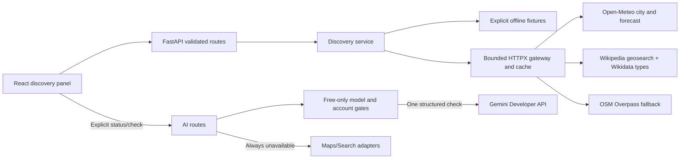

# Architecture — Phase 6 final local release

## Boundaries

- `frontend/src/components/DiscoveryPanel.tsx`: explicit city choice, independent loading/errors, cancellation, provenance and opt-in demo.
- `frontend/src/services/discovery.ts` and `types/discovery.ts`: typed requests/responses; 30-second city/weather and 50-second place timeouts.
- `backend/app/api/routes/discovery.py`: input validation; server-resolved IDs, known modes/categories and bounded dates/radii.
- `backend/app/services/discovery.py`: normalization, local forecast window, place deduplication and provenance.
- `backend/app/services/gateway.py`: fixed official endpoints, shared HTTPX client, serialization, cache and budgets.
- `backend/app/services/demo.py`: offline fixtures; no live failure silently becomes a demo result.
- `backend/app/main.py`: client lifecycle, local CORS and safe errors. Tests inject mock transport and time.
- `backend/app/services/gemini.py`: official SDK client, fixed endpoint, model allowlist, budgets, cooldown and structured response validation.
- `backend/app/services/research.py`: separate Google Maps/Search capability gates; no grounding tool is created.
- `backend/app/api/routes/ai.py`: read-only status, explicit connection check and structured research-unavailable result.
- `frontend/src/components/AIConnectionPanel.tsx`: no automatic call; status and model request are separate actions.

## Contracts

Search `/api/destinations?q=Paris&language=en&mode=live`, optionally `country_code=FR`. Up to 10 populated-place candidates carry country, region, coordinates, time zone and GeoNames link. The user selects one; weather/places use that `destination_id` and the same `mode`.

`/api/weather` requires start/end dates (1–14 inclusive days). Only the intersection with today through today + 15 in the destination time zone is fetched. Returned days preserve the original dates. Missing values are null; unavailable days use `missing_data` or `outside_forecast_horizon`. No different-date forecast or historic weather is substituted. Units: °C, mm, percent. Status: ok/partial/unavailable.

`/api/places` requires 1–5 repeated `categories`: museum/historic/park/attraction/restaurant. Radius: 250–3000 metres (UI: 1500). The primary path requests up to 250 nearby, primary-coordinate Wikipedia pages and classifies only requested types through Wikidata; up to 40 survive validation. If Wikimedia fails, a bounded Overpass query provides an independent real-data fallback. Truncation and omitted records are explicit. UI interests map culture → historic/museum, art → museum, nature → park, food → restaurant.

Places retain stable Wikidata or OSM IDs and record links. Wikipedia-backed results add a short article extract, thumbnail, direct article URL and a summed 30-day pageview count. Requested categories are interleaved so a dense museum category cannot hide restaurants; entries within each category prefer higher pageviews and then proximity. Pageviews are presented as public interest, never as a rating. Known coordinates beyond the radius are omitted. OSM fallback records preserve missing-coordinate and geometry-center caveats. Distances are straight-line. Indoor/outdoor evidence distinguishes provider tags, category inference and unknown. No invented prices, ratings, hours or walking times.

Metadata includes mode, source/link, fetched timestamp and cache status. No-fetch weather has no timestamp; demo has no external source link. HTTP 422 indicates input errors, 409 expired/unknown city, 429 limits and 503 provider failures. Safe errors do not echo notes or credentials; Retry-After is forwarded where applicable.

## Gemini connection contract

`GET /api/ai/status` reports safe configuration and in-process verification state without contacting Google. `POST /api/ai/check` accepts only `{ "language": "tr" | "en" }`; extra fields are rejected before any external call. It sends a fixed connection prompt, not trip details or notes.

The call is enabled only when free-only mode is true, the exact reviewed model is configured, a server-side key exists, and the operator has attested that its project uses eligible Free tier without billing. The application cannot inspect billing state, so the attestation is always reported separately from a successful model response.

The official SDK is forced to the Gemini Developer API host and a fixed model ID. Environment variables cannot redirect it to Vertex/Enterprise or another host. SDK retries, grounding tools, automatic function execution and paid service tiers are absent. The connection check still requires no function call. Itinerary generation uses a manual bounded loop with only `get_weather` and `search_places`; every call and final proposal is validated by the backend. Status records only the success time; it does not log keys, hidden reasoning or raw provider payloads.

`POST /api/research` exposes the independent adapter behavior for `google_maps` or `google_search`: status `unavailable`, no citations/content and `osm_discovery` fallback. Configuration flags record intent but cannot activate tools whose reviewed free-tier gate failed.

## Resource bounds

| Resource | Default / behavior |
|---|---|
| Request deadline | 25 seconds, including queue/rate-limit waits |
| Response limit | 2 MB; no redirects |
| Concurrency | One request per provider group: Meteo, Wikimedia or Overpass |
| Minimum spacing | Meteo/Wikimedia 1 second; Overpass 3 seconds |
| Call budget | 120/hour and 600/day per group/process; retries count |
| Retry | At most once for 502/503/504 with short wait; none for 429 |
| Cooldown | Retry-After respected; no endpoint/key rotation |
| Cache | LRU 128 entries; city 24 hours, weather 15 minutes, places 1 hour |
| City registry | 500 mode-scoped IDs, 24-hour expiry |
| Gemini deadline / response | 25 seconds / 256 KiB |
| Gemini concurrency | One live check; additional requests receive 429 instead of queuing |
| Gemini local budget | 2/minute and 10/day per process; successful and failed external calls count |
| Gemini retry | SDK attempts = 1; no application retry; 429 Retry-After/RetryInfo starts cooldown |

Caches and limits reset on restart. JSON parse, oversize and provider runtime errors are not cached. Structurally invalid data is rejected before display, though a JSON-valid discovery body can remain cached until expiry. Local budgets are safeguards, not a billing or distributed quota guarantee.

## Product layer

Phase 4 added validated function declarations, a bounded dispatcher, tool responses, itinerary consistency checks, SQLAlchemy/SQLite persistence and evidence-reusing revisions. If food is selected, both deterministic and Gemini proposals must contain exactly one verified restaurant per day; another selected interest also requires at least one non-restaurant stop per day. Phase 5 adds an idempotent generation boundary, a shared itinerary view with separate visit and food sections, a lazy-loaded Leaflet map, source/navigation links and complete saved-trip CRUD screens. Map-tile failure is isolated from the itinerary list. See [phase-4-agent.md](phase-4-agent.md) for the agent contract and [phase-5-product.md](phase-5-product.md) for the UI contract.
